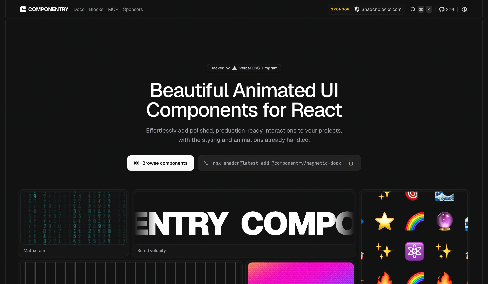

<div align="center">
  
</div>


<h1 align="center">DavinciUI</h1>

<p align="center">
  <strong>Beautiful, interactive UI components you can copy and paste into your apps.</strong>
</p>

<p align="center">
  Crafted with React, Tailwind CSS, and Framer Motion. Open source. Free forever.
</p>

<p align="center">
  <a href="https://davinciui.com">Documentation</a> ·
  <a href="https://davinciui.com/docs/components">Components</a> ·
  <a href="https://github.com/sorkhademanthan/davinciui/issues">Report Bug</a> ·
  <a href="https://github.com/sorkhademanthan/davinciui/issues">Request Feature</a>
</p>

<p align="center">
  <a href="https://github.com/sorkhademanthan/davinciui/blob/main/LICENSE">
    
  </a>
  <a href="https://github.com/sorkhademanthan/davinciui/stargazers">
    
  </a>
  <a href="https://twitter.com/ManthanSorkhade">
    
  </a>
</p>

---

## Introduction

DavinciUI is a collection of 140+ beautifully designed, interactive UI components built with React and Tailwind CSS. No bloated dependency — you own the code. Just run the CLI command, add the component to your project, and start building.

### Why DavinciUI?

- **Copy & Paste** — Not a dependency. The code lives in your project, fully yours.
- **Interactive** — Cursor-following effects, 3D transforms, and buttery-smooth animations.
- **Customizable** — Built with Tailwind CSS. Restyle anything in seconds.
- **Accessible** — WAI-ARIA compliant components with keyboard and reduced-motion support.
- **Dark Mode** — Every component looks stunning in light and dark modes.
- **TypeScript** — Fully typed for the best developer experience.
- **AI-ready** — Ships with `llms.txt` and an MCP setup so coding assistants install it correctly.

## Quick Start

### Prerequisites

A React project with [shadcn](https://ui.shadcn.com/docs/installation) already initialized.

### Installation via CLI

The fastest way to add components:

```bash
pnpm dlx shadcn@latest add @davinciui/text-morph
```

Then use it anywhere:

```tsx
import { TextMorph } from "@/components/ui/text-morph";

export function Hero() {
  return <TextMorph words={["Design", "Animate", "Delight"]} />;
}
```

Browse all components at [davinciui.com/docs/components](https://davinciui.com/docs/components) — every page shows the exact install command.

### Manual installation

Prefer to read the code first? Every component's source is open in [`packages/ui/src/components`](./packages/ui/src/components) — copy the file into your project's `@/components/ui` folder and install its listed dependencies.

## What's Inside

- **140+ components & blocks** — cards, heroes, navigation, effects, backgrounds, and more, each with live previews and docs.
- **Design-system builder** — define palettes, type, spacing, themes, and export production tokens, right in the browser at [davinciui.com/design-system](https://davinciui.com/design-system).
- **Dark mode everywhere** — previews, docs, and components all adapt.

## Development

This project uses [Turborepo](https://turbo.build/repo) for monorepo management.

### Prerequisites

- Node.js 20+
- pnpm 10+

### Setup

```bash
# Clone the repository
git clone https://github.com/sorkhademanthan/davinciui.git
cd davinciui

# Install dependencies
pnpm install

# Start development server
pnpm dev
```

### Project Structure

```
davinciui/
├── apps/
│   └── web/                 # Documentation site (Next.js)
├── packages/
│   ├── ui/                  # Component library
│   ├── eslint-config/       # Shared ESLint configuration
│   └── typescript-config/   # Shared TypeScript configuration
└── turbo.json               # Turborepo configuration
```

### Available Scripts

| Command | Description |
|---------|-------------|
| `pnpm dev` | Start development server |
| `pnpm build` | Build all packages |
| `pnpm lint` | Run linting |
| `pnpm format` | Format code with Prettier |

## Contributing

We welcome contributions! Whether it's:

- Reporting a bug
- Submitting a fix
- Proposing new features
- Creating new components

### How to Contribute

1. Fork the repository
2. Create your feature branch (`git checkout -b feature/amazing-component`)
3. Commit your changes (`git commit -m 'Add amazing component'`)
4. Push to the branch (`git push origin feature/amazing-component`)
5. Open a Pull Request

### Component Guidelines

When creating new components:

- Use TypeScript with proper type definitions
- Support both light and dark modes
- Include comprehensive props with sensible defaults
- Add smooth transitions and animations
- Write clear documentation with examples
- Follow existing code style and patterns

## Tech Stack

- **Framework**: [Next.js 16](https://nextjs.org/)
- **Styling**: [Tailwind CSS 4](https://tailwindcss.com/)
- **Components**: [React 19](https://react.dev/)
- **Motion**: [Framer Motion](https://motion.dev/)
- **Build**: [Turborepo](https://turbo.build/repo)
- **Package Manager**: [pnpm](https://pnpm.io/)

## License

MIT License — feel free to use these components in personal and commercial projects.

## Third-Party Licenses

Some components use third-party dependencies with separate license terms.

- `image-trail` and `layered-stack` require `gsap` (GSAP).
- If you use or redistribute those components, you are responsible for complying with GSAP's license terms.
- GSAP license: https://gsap.com/licensing/

See [LICENSE](./LICENSE) for more information.

## Acknowledgments

- Inspired by [shadcn/ui](https://ui.shadcn.com/)
- Built with [Tailwind CSS](https://tailwindcss.com/)
- Powered by [Vercel](https://vercel.com/)

<p align="center">
  <a href="https://star-history.dera.page/#sorkhademanthan/davinciui&Date">
    <picture>
      <source
        media="(prefers-color-scheme: dark)"
        srcset="https://star-history.dera.page/svg?repos=sorkhademanthan/davinciui&type=Date&theme=dark&legend=top-left"
      />
      <source
        media="(prefers-color-scheme: light)"
        srcset="https://star-history.dera.page/svg?repos=sorkhademanthan/davinciui&type=Date&legend=top-left"
      />
      
    </picture>
  </a>
</p>

---

<p align="center">
  Made with care by <a href="https://twitter.com/ManthanSorkhade">Manthan Sorkhade</a>
</p>
